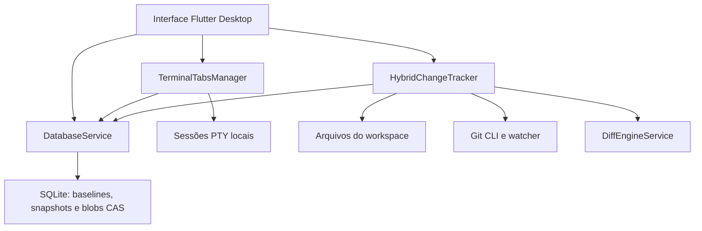

# Terminal Agente

Aplicação Desktop Multiplataforma (**Linux, Windows e macOS**) construída em **Flutter**, projetada para integrar um **Terminal Real Multi-Abas** (`xterm` + `flutter_pty`) com **Detecção Híbrida de Arquivos Alterados (Git + File Watcher)**, **Visualizador Interativo de Diff (Lado a Lado e Unificado)**, **Rollback Granular (por bloco, por arquivo ou por linha do tempo)** e **Banco de Dados Local SQLite com Content-Addressable Storage (CAS)**.

---

## Principais Funcionalidades

1. **Layout de 3 Colunas Redimensionáveis (`MultiSplitView`)**:
   * **Coluna 1 — Arquivos Alterados & Timeline**: Lista em tempo real arquivos modificados (`M`), adicionados (`A`), removidos (`D`) e não rastreados (`U`) com contadores `+X / -Y`, além da aba de **Timeline de Snapshots** armazenados no SQLite.
   * **Coluna 2 — Visualizador Interativo de Diff**: Alternância instantânea entre **Lado a Lado (Split View: Como Estava vs. Como Ficou)** e **Unificado (Unified View)**, com destaque de caracteres intra-linha e botões de **Reverter este bloco** (`DiffHunk`) ou **Reverter Arquivo**.
   * **Coluna 3 — Terminal Integrado Multi-Abas & Snippets de Agentes**: Múltiplas sessões de pseudoterminal nativas (`bash`, `zsh`, `powershell`), histórico de comandos e saída do terminal em SQLite com gravação desativada por padrão (opt-in explícito), e barra de botões rápidos para disparar agentes CLI (`Claude Code`, `Gemini CLI`, `Aider AI`, `Git Status`, `Git Diff`, `Flutter Test` ou comandos customizados).

---

## Visão técnica da arquitetura

Este é um projeto pessoal de aplicação desktop, organizado em componentes de interface, serviços de acompanhamento de arquivos, sessões de terminal e persistência local.



**Responsabilidades principais**

- `lib/main.dart` e `lib/widgets/`: composição da interface e integração das ações de edição, comparação e restauração.
- `terminal_session_controller.dart`: gerenciamento de abas e sessões de terminal; o conteúdo de comandos e saídas só é persistido quando a gravação é habilitada explicitamente na compilação.
- `hybrid_change_tracker.dart`: leitura de arquivos de texto elegíveis no workspace, acompanhamento de mudanças, baselines, snapshots e operações de restauração.
- `diff_engine_service.dart`: cálculo e manipulação de diferenças para comparação e reversão de trechos.
- `database_service.dart`: armazenamento local em SQLite, deduplicação por hash SHA-256 de conteúdo textual, consultas e estatísticas de armazenamento.

**Decisões e limites:** os snapshots e baselines locais não são um substituto para Git ou backup. Arquivos comuns podem conter segredos que não são reconhecidos pelas exclusões preventivas; o banco não deve ser considerado um armazenamento criptografado. As rotinas de restauração possuem validações de workspace e caminhos, mas não garantem proteção contra todas as condições de corrida do sistema de arquivos. A pipeline executa análise estática e testes Flutter, sem validar os pacotes distribuíveis em cada sistema operacional.

---

## Implementação e evidências

Os componentes principais estão em `lib/services/` (persistência SQLite, diff, monitoramento de arquivos e sessões de terminal) e `lib/widgets/` (interface). Há testes de persistência, comparação e rollback, sessões e widgets em `test/`.

O [workflow Flutter quality](.github/workflows/flutter.yml) executa `flutter analyze` e `flutter test` em pull requests e na branch principal. Esses testes não equivalem à validação completa da interface desktop, dos empacotadores ou do funcionamento em Linux, Windows e macOS.

**Privacidade e operação local:** a gravação de novos comandos e da saída do terminal no SQLite está **desativada por padrão**. A sessão de terminal continua funcionando, mas o histórico salvo de novos comandos não será preenchido. Para permitir esse armazenamento conscientemente ao executar em desenvolvimento, use `flutter run -d linux --dart-define=TERMINAL_AGENTE_RECORD_HISTORY=true` (ou ajuste a plataforma). Ao empacotar, a opção deve ser definida explicitamente no build. O valor é definido no momento da compilação, não é uma preferência editável na interface.

**Limitação dos snapshots:** o rastreador agora exclui arquivos sensíveis comuns (por exemplo, `.env`, chaves `.pem`/`.key`, `.npmrc` e chaves SSH) antes de capturar baselines ou snapshots. Essa proteção não detecta todos os possíveis segredos embutidos em arquivos de texto normais e não limpa registros antigos.

A alteração **não apaga dados armazenados por versões anteriores**, nem impede que snapshots de arquivos guardem conteúdo sensível no banco. Quando habilitado, o histórico de comandos e saídas não é criptografado pela aplicação e pode conter senhas, tokens, caminhos privados e dados de trabalho. Não trate o banco como cofre de segredos. A saída do terminal continua visível na sessão ativa mesmo com a gravação desabilitada.

**Limpeza explícita:** a camada de persistência oferece `DatabaseService.clearTerminalHistoryForWorkspace(workspaceId)` para remover comandos e saídas previamente gravados de um workspace específico, sem tocar nos registros de outros workspaces, snapshots ou baselines. **Não há botão de interface ou limpeza automática para essa operação**; ela só é executada quando chamada pelo código. Isso não é uma eliminação forense: cópias de segurança, WAL e armazenamento subjacente podem reter vestígios dos dados.

**Conteúdo CAS sem referências:** a camada SQLite também oferece `DatabaseService.pruneUnreferencedContentBlobs()` para remover, somente quando chamada explicitamente pelo código, blobs que não sejam usados por nenhum snapshot ou baseline de qualquer workspace. Isso **não** implementa uma política de retenção de snapshots, limpeza automática, interface de exclusão ou apagamento seguro de dados em disco, backups e WAL.

**Diagnóstico de armazenamento (somente leitura):** `DatabaseService.getStorageStatistics()` fornece contagens de workspaces, snapshots, arquivos de snapshot, baselines, blobs, sessões, logs e comandos, além dos bytes lógicos de conteúdo de blobs, logs e comandos. Os números não representam o espaço físico do arquivo SQLite, WAL ou backups. A função não está exposta na interface e não implementa exclusão ou retenção automática.

**Rollback:** a reversão escreve alterações em arquivos locais. Faça backup ou use Git antes de reverter; os testes cobrem cenários específicos, não todas as condições de concorrência, conflitos e arquivos binários.

**Distribuição:** existem scripts de empacotamento para Linux, Windows e macOS, mas sua presença não comprova compatibilidade ou instalação validada em cada plataforma. Os scripts verificam a existência de componentes essenciais do build e se os arquivos finais foram gerados com conteúdo; isso não substitui teste de instalação, execução, assinatura ou verificação de integridade criptográfica. A pasta `dist/` é gerada localmente e ignorada pelo Git; a pipeline atual não compila nem publica pacotes de distribuição. Pacotes Linux previamente commitados continuam acessíveis nos commits históricos, mas não devem ser tratados como builds verificados, assinados ou prontos para distribuição.

---

## Como Executar em Desenvolvimento

```bash
# Instalar dependências
flutter pub get

# Executar testes automatizados e análise estática
flutter test && flutter analyze

# Executar aplicação no Desktop (Linux / Windows / macOS)
flutter run -d linux   # ou -d windows / -d macos
```

---

## Como Gerar Executáveis Standalone (Autoexecutáveis)

* **Linux (`AppImage` e Bundle Portátil `.tar.gz`)**:
  ```bash
  ./packaging/build_linux_appimage.sh
  ```
* **Windows (`Standalone .exe` + `.zip` com DLLs embarcadas)**:
  ```powershell
  .\packaging\build_windows_standalone.ps1
  ```
* **macOS (`.app` / `.dmg` autocontido)**:
  ```bash
  ./packaging/build_macos_standalone.sh
  ```
