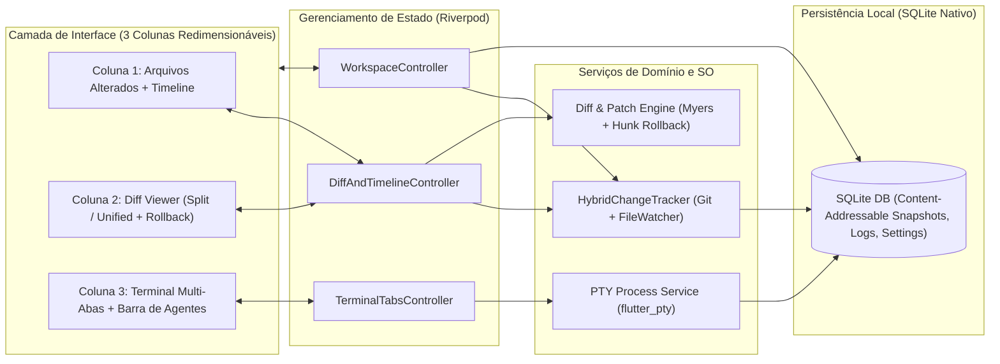
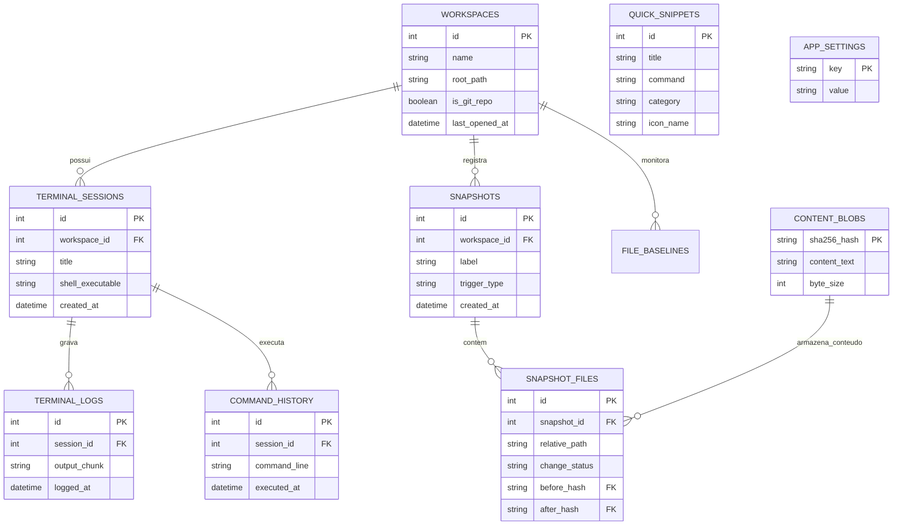

# Plano de Arquitetura e Implementação — Terminal Agente (Flutter Desktop)

Aplicação desktop multiplataforma (**Linux, Windows e macOS**) construída em **Flutter**, projetada para integrar um **Terminal Real Multi-Abas** (ideal para rodar shells e agentes de IA via CLI como Claude, Gemini, Codex, Aider, etc.) com uma **Visão em Tempo Real de Arquivos Alterados**, **Visualizador de Diff (Lado a Lado e Unificado)**, **Rollback granular (por bloco, arquivo ou linha do tempo)** e **persistência completa em SQLite**.

---

## 1. Visão Geral da Arquitetura

Adotaremos uma arquitetura em camadas reativa utilizando **Riverpod** para injeção de dependência e estado, isolando os serviços nativos de sistema operacional (PTY, File Watcher, Git e SQLite).



---

## 2. Stack Tecnológica e Pacotes (`pubspec.yaml`)

| Categoria | Pacote | Finalidade |
| :--- | :--- | :--- |
| **Terminal & PTY** | `xterm`, `flutter_pty` | Emulação completa VT100/ANSI/256-colors com pseudoterminal nativo (`bash`/`zsh` no Linux/macOS, `powershell`/`cmd` no Windows). |
| **Banco de Dados Local** | `sqlite3`, `sqlite3_flutter_libs`, `path_provider` | SQLite embarcado autocontido (empacota `.so`, `.dll` e `.dylib` automaticamente no executável final). |
| **Diff & Patch** | `diff_match_patch`, `crypto` | Cálculo de diferenças linha a linha e caractere a caractere, geração de blocos (*hunks*) para rollback parcial e hash SHA-256. |
| **Monitoramento** | `watcher`, `process_run` | Observação de eventos do sistema de arquivos em tempo real + integração com comandos `git` quando disponíveis. |
| **Interface Desktop** | `multi_split_view`, `file_picker`, `google_fonts` | Painéis divisíveis redimensionáveis pelo usuário, seleção nativa de diretórios e tipografia monoespaçada nítida (*JetBrains Mono* / *Fira Code*). |
| **Estado** | `flutter_riverpod` | Reatividade entre eventos do terminal, alterações em disco, snapshots no SQLite e atualização instantânea da UI. |

> [!TIP]
> Para evitar que o banco SQLite cresça excessivamente ao salvar vários snapshots de arquivos, usaremos **Content-Addressable Storage (CAS)** dentro do SQLite: o conteúdo de cada arquivo é indexado pelo seu hash `SHA-256` na tabela `content_blobs`. Se um arquivo não mudou entre dois snapshots, apenas a referência ao hash é gravada!

---

## 3. Modelagem do Banco de Dados SQLite

O banco de dados local armazenará configurações, workspaces, sessões e logs de terminal, snippets de agentes e os snapshots da linha do tempo.



---

## 4. Funcionamento dos Módulos Principais

### 4.1. Motor de Detecção Híbrido (`HybridChangeTracker`)
1. **Ao abrir uma pasta (Workspace)**:
   * Verifica se existe `.git`.
   * Captura um **Baseline Snapshot** de todos os arquivos de texto relevantes (ignorando automaticamente `.git/`, `build/`, `node_modules/`, `.dart_tool/`, binários grandes) e salva os hashes/conteúdos no SQLite.
2. **Durante a execução no Terminal**:
   * O `DirectoryWatcher` escuta modificações, criações e exclusões em tempo real (com *debounce* de 300ms para agrupar salvamentos rápidos de agentes CLI).
   * Se o workspace tiver Git, consulta `git status --porcelain` e `git diff HEAD` para enriquecer o status, mas mantém os snapshots no SQLite para permitir **Timeline e Rollback mesmo em arquivos não commitados ou projetos sem Git**.
   * A cada ciclo de alteração detectada, gera um registro na **Timeline de Snapshots** para que o usuário possa navegar pelo histórico da sessão.

### 4.2. Visualizador de Diff e Rollback Granular (`DiffEngine`)
* **Modos de Visualização**:
  * **Lado a Lado (Split View)**: Coluna "Como Estava (Antes)" à esquerda e "Como Ficou (Agora)" à direita, com numeração de linhas dupla, scroll sincronizado e destaque intra-linha dos caracteres alterados.
  * **Unificado (Unified View)**: Visão contínua com linhas removidas em vermelho (`-`) e adicionadas em verde (`+`).
* **Três níveis de Rollback (Desfazer)**:
  1. **Reverter Bloco (Hunk Rollback)**: Cada bloco de linhas modificadas no Diff possui um botão `"Reverter este trecho"`, que restaura apenas aquelas linhas para o estado anterior sem perder o restante do arquivo.
  2. **Reverter Arquivo**: Botão na lista de arquivos ou no topo do diff para restaurar o arquivo inteiro ao estado original/snapshot selecionado.
  3. **Restaurar Ponto da Timeline**: Na aba *Timeline*, o usuário pode clicar em qualquer ponto anterior da sessão para comparar ou restaurar todos os arquivos daquele momento.

### 4.3. Terminal Multi-Abas e Snippets de Agentes
* Múltiplas abas independentes por workspace (`+ Nova Aba`, renomear, fechar).
* Interceptação do stream de entrada/saída do PTY para:
  * Gravar logs assíncronos no SQLite (`terminal_logs`) e detectar comandos enviados (`Enter`) para popular o `command_history`.
* **Barra de Ações Rápidas / Snippets**: Botões prontos e customizáveis (salvos no SQLite) para injetar comandos no terminal ativo com 1 clique (ex.: `claude`, `gemini`, `aider`, `git status`, `flutter test`, etc.).

---

## 5. Layout das 3 Colunas (UI Amigável)

```
+--------------------------------------------------------------------------------------------------+
| [Pasta: /meu/projeto] [Badge: Git Ativo]   |  [+ Criar Snapshot]  [Modo: Split | Unified]  [Cfg] |
+---------------------------+----------------------------------------+-----------------------------+
| COLUNA 1: ARQUIVOS & TIME | COLUNA 2: VISUALIZADOR DE DIFF         | COLUNA 3: TERMINAL & AGENTES|
| [Abas: Alterados (3) |    |📄 src/main.dart     [Reverter Arquivo] | [Aba 1: bash] [Aba 2: +]    |
|        Timeline (8)]      |----------------------------------------| [⚡Claude][⚡Gemini][⚡Git]  |
|                           | ANTES (Original)  | DEPOIS (Atual)     |-----------------------------|
| M  src/main.dart   +12 -4 | 10 void main() {  | 10 void main() {   | dan@pc:~/projeto$ claude    |
| A  src/helper.dart +45 -0 | 11 - print("Oi"); | 11 + runApp(App());| > Analisando src/main.dart  |
| D  old_config.json +0 -18 |    [Reverter este bloco ↺]             | > Arquivo atualizado!       |
|                           | 12 }              | 12 }               | dan@pc:~/projeto$ █         |
+---------------------------+----------------------------------------+-----------------------------+
| Status: Monitorando alterações em tempo real | SQLite: Conectado | 3 arquivos alterados          |
+--------------------------------------------------------------------------------------------------+
```

---

## 6. Empacotamento Autoexecutável (Standalone)

Configuraremos scripts automatizados na pasta `packaging/` do projeto:
* **Linux (`AppImage`)**: Script `packaging/build_appimage.sh` que executa `flutter build linux --release`, monta a estrutura `AppDir` com ícone, `.desktop` e todas as bibliotecas `.so` (incluindo `libflutter_pty` e `libsqlite3`), gerando um único arquivo `TerminalAgente-x86_64.AppImage` autoexecutável.
* **Windows (`Standalone Portable` / `.exe`)**: Script `packaging/build_windows.ps1` que compila `flutter build windows --release` e empacota o executável autocontido com as DLLs nativas.
* **macOS (`.app` / `.dmg`)**: Script `packaging/build_macos.sh` que gera o bundle `.app` autocontido.

---

## 7. Fases de Execução

1. **Fase 1 — Scaffolding e Estrutura Base**: Criar o projeto Flutter Desktop (`linux`, `windows`, `macos`), configurar dependências no `pubspec.yaml` e tema visual escuro moderno.
2. **Fase 2 — Banco de Dados SQLite (CAS + Repositórios)**: Implementar o serviço SQLite completo com armazenamento de blobs SHA-256, snapshots, histórico de terminal, snippets e configurações.
3. **Fase 3 — Motor de Diff, Hunk Rollback e Hybrid Watcher**: Implementar o rastreador de arquivos (Git + FileWatcher), cálculo de diffs por linha/caractere e funções de restauração por bloco, arquivo e timeline.
4. **Fase 4 — Terminal Multi-Abas (`xterm` + `flutter_pty`)**: Integrar o terminal nativo com múltiplas abas, captura de comandos/logs no SQLite e barra de Snippets/Agentes.
5. **Fase 5 — Interface de 3 Colunas e Empacotamento**: Construir a UI com `multi_split_view`, testar a compilação nativa no Linux e criar os scripts geradores de `AppImage` e pacotes standalone.
